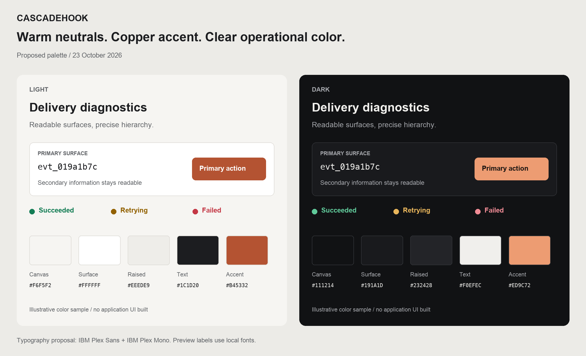

# Cascadehook frontend: research and proposed direction

Research date: 2026-10-23. Status: visual direction approved; landing and account
entry implemented as the first frontend slice.

## Recommendation

Use warm off-white and graphite surfaces, a restrained copper action color, IBM
Plex Sans with IBM Plex Mono for technical values, and compact, carefully aligned
operational views. Make delivery investigation the defining experience: find a
delivery, understand its state, inspect its attempts, and replay when appropriate.

The colors, dimensions, timing values, and layouts below are original proposals
for Cascadehook. They are not extracted tokens or measured performance claims
about another product. References inform the decisions; their branding and screens
are not templates to reproduce.

## Research method

- Reviewed designer-published Dribbble concepts, first-party product screenshots,
  design articles, product documentation, and accessibility/performance guidance.
- Used public web research. No browser, GUI preview, signed-in product session, or
  local app was opened. Product interactions and responsive behavior were not
  tested hands-on; distinguish documented behavior from recommendations below.
- Checked the existing Go read contracts and scaffold to keep proposals grounded
  in available data. That research pass did not change application code or dependencies.

## Reference shortlist

| Reference | Published evidence | Application to Cascadehook |
| --- | --- | --- |
| [Developer Dashboard — Sam](https://dribbble.com/shots/27184432-Developer-Dashboard) | Designer-published palette includes near-white `#F6F6F6`, charcoal `#111214`, and several neutral grays. | Explore a neutral foundation with clear surface levels. Palette inspiration alone does not establish usability or responsive behavior. |
| [API & Webhook Dashboard — Alvin R](https://dribbble.com/shots/27447632-Developer-Platform-UI-API-Webhook-Dashboard) | The designer describes dark slate, indigo/mint accents, JSON previews, logs, and cinematic motion. | Relevant developer-tool subject matter and code/detail hierarchy. Keep operational status and payload inspection; prioritize legibility and short purposeful feedback over cinematic treatment. |
| [Linear: A calmer interface for a product in motion](https://linear.app/now/behind-the-latest-design-refresh) | The 2026 refresh reduces sidebar prominence, icon treatments, and separators, and adjusts the default palette toward less saturated warm grays. | Let working content carry more visual weight than navigation. Define a consistent header, restrained borders, and balanced neutral surfaces in both themes. |
| [Resend product screenshot](https://resend.com/brand) and [Email API](https://resend.com/features/email-api) | The official screenshot presents navigation, filtering, and an email-status table; the product page describes request-header and response-body inspection. | Use a clear list/detail relationship and easily scanned status text. Cascadehook's available diagnostic fields differ; see the contract section below. |
| [Hookdeck: Events & Attempts](https://hookdeck.com/docs/events) | Documents paginated history, distinct events/attempts, and a detail sidebar whose attempt selection controls the shown response. | Preserve list context while investigating a delivery. Keep event identity, delivery state, and attempt history conceptually separate. |
| [Stripe webhook delivery troubleshooting](https://docs.stripe.com/webhooks#view-event-deliveries) | Documents delivery statuses, HTTP response information, scheduled retries, and individual resend actions. | Make current state, failure context, and the next scheduled action easy to locate. Replay acceptance must remain distinct from delivery success. |

Additional design-system references:

- [Linear's redesign process](https://linear.app/now/how-we-redesigned-the-linear-ui)
  discusses validating complete views, hierarchy, and a common light/dark color
  system. Adapt that discipline by proving one demanding screen in both themes.
- [Radix color-scale roles](https://www.radix-ui.com/colors/docs/palette-composition/understanding-the-scale)
  distinguish surfaces, interactive states, borders, solid fills, and text.
  Use those semantic distinctions without requiring a new color library.
- [IBM Plex](https://www.ibm.com/design/language/typography/typeface/) provides
  related sans and mono families. Their relationship is useful for combining
  ordinary labels with identifiers, payloads, and code examples.

## Visual system proposal

### Color

Use the same semantic roles with independently chosen values in each theme.
Light mode should feel complete and intentional. Dark mode should retain readable
secondary information and distinct surfaces. Do not mechanically invert colors.

| Role | Light | Dark |
| --- | --- | --- |
| Canvas | `#F6F5F2` | `#111214` |
| Primary surface | `#FFFFFF` | `#191A1D` |
| Raised/hover surface | `#EEEDE9` | `#232428` |
| Primary text | `#1C1D20` | `#F0EFEC` |
| Secondary text | `#626569` | `#A3A5AA` |
| Decorative divider | `#DEDCD7` | `#303236` |
| Input boundary | `#7D8188` | `#777B85` |
| Brand/action/focus | `#B45332` | `#ED9C72` |
| Text on filled action | `#FFFFFF` | `#1A1411` |
| Success text/icon | `#147D55` | `#60C99A` |
| Warning text/icon | `#926100` | `#E8B55B` |
| Failure text/icon | `#C43845` | `#F08B95` |

Keep most of the workspace neutral. Copper identifies the principal action and
selected context. Operational colors retain stable meanings and always accompany
text or an icon. Copper is not a warning state. Selection needs a distinguishable
shape/background as well as color. Tune selected, hover, disabled, focus, badge,
and chart pairings separately during implementation.

Calculated WCAG sRGB contrast checks for the proposed opaque pairs:

| Pair | Ratio |
| --- | --- |
| Light primary text / canvas | 15.46:1 |
| Light secondary text / canvas | 5.37:1 |
| Light copper text / canvas | 4.56:1 |
| White text / light action fill | 4.97:1 |
| Dark primary text / canvas | 16.30:1 |
| Dark secondary text / primary surface | 7.06:1 |
| Dark copper text / primary surface | 7.95:1 |
| Dark action label / copper fill | 8.33:1 |
| Light input boundary / white surface | 3.91:1 |
| Dark input boundary / primary surface | 4.11:1 |

These are numeric checks, not a completed accessibility audit. Decorative
dividers are not substitutes for the stronger cues needed to identify controls.
Check actual foreground/background pairs, including states, opacity, and overlays.
The light copper/canvas pairing has limited margin and should remain opaque.
Normal text generally needs 4.5:1; essential control/graphic cues generally need
3:1. Sources: [text contrast](https://www.w3.org/WAI/WCAG22/Understanding/contrast-minimum.html)
and [non-text contrast](https://www.w3.org/WAI/WCAG22/Understanding/non-text-contrast.html).

If a cooler brand is preferred, a cobalt alternative is `#2457D6` in light mode
and `#8BA6FF` in dark mode, using the same neutral foundation. This is an
alternative for discussion, not a second theme users need to configure.

### Type, spacing, and shape

- Use sentence case for interface copy, including small labels and section
  introductions. Do not apply uppercase or capitalize text transforms.
- Proposed typography: IBM Plex Sans for navigation, labels, and headings; IBM
  Plex Mono for IDs, HTTP values, durations, code, and payloads. Use tabular
  numerals for aligned counts and durations.
- Start with 14px operational text, 16px form text, 12px supplementary metadata,
  and 24–28px page headings. Do not make essential diagnostics tiny to fit more
  columns. Confirm these choices manually with realistic data.
- Use a 4px spacing rhythm: 8px within controls, 12–16px between related items,
  24–32px between sections. Begin with approximately 44px desktop log rows and
  increase height on touch layouts and when content wraps.
- Use 6–8px control radii and around 10–12px for dialogs/popovers. Reserve pills
  for concise statuses and filter selections. Elevation should explain layering.
- Keep Phosphor icons consistent: regular weight, usually 16–20px; selection
  may use a heavier weight alongside an explicit active treatment. Label
  ambiguous actions and give icon-only controls accessible names.
- Use real content hierarchy and alignment to create character. Repeated metric
  tiles, large decorative gradients, glows, ornamental charts, and nested cards
  would distract from delivery investigation.

## Layout and responsive behavior

These widths are starting points to tune against content, not device guarantees.

The current dashboard trial uses a full-width shell with a 224px sidebar,
a 68px collapsed rail, a 60px context header, and 32px desktop content gutters.
At 900px and below, navigation moves into a native modal drawer. Page headings
replace the repeated project banner; project ID and role are in Settings.
Operational lists use the available content width, while forms and guide text
keep a readable maximum width. The table below describes the broader direction,
including the future side-by-side inspector.

| Space | Proposed behavior |
| --- | --- |
| Wide desktop, roughly 1280px+ | Approximately 224–240px navigation; short context header; delivery list beside a 400–440px inspector when both remain readable. |
| Tablet/small desktop, roughly 768–1279px | Collapsible navigation. Use a full detail view when list plus inspector would compress either. Let filters wrap or move into an accessible sheet. |
| Phone, below roughly 768px | Compact top bar with organization/project context and navigation drawer. Prioritize status, identity, and time in stacked log rows. Detail becomes a full view with a clear back action. |

- Preserve filters, pagination, selection, and scroll context when returning from
  detail. Keep non-sensitive filter and selection state in the URL where useful.
- Never put tokens, one-time secrets, or event payloads in the URL.
- Make payload/code scrolling local; long identifiers must not widen the page.
  Include a labeled copy control and a way to inspect the complete value.
- Ordinary UI should reflow at 320 CSS px. A genuine two-dimensional table may
  scroll within its own region; its surrounding navigation and filters should
  still fit. [W3C reflow guidance](https://www.w3.org/WAI/WCAG22/Understanding/reflow.html)
- Aim for 40–44px touch hit areas even when icon artwork is smaller. WCAG AA's
  24px target minimum has exceptions; the larger touch size is a product choice.
  [W3C target size](https://www.w3.org/WAI/WCAG22/Understanding/target-size-minimum.html)
- Keep essential actions available without hover. Retain visible focus, logical
  keyboard order, dialog focus management, and a working Escape/back path.

## Make speed part of the interaction design

Recommended behavior:

- Acknowledge input immediately: pressed states, submitting labels, and focused
  controls. Do not wait for a network response before showing that an action began.
- Keep cached rows visible during background refresh. Preserve selection and
  focus. Avoid reordering a list while someone is investigating a delivery;
  offer an explicit new-results refresh when appropriate.
- Use skeletons shaped like the eventual view and reserve their space. Distinguish
  initial loading from a quiet background refresh.
- Use cursor pagination and bounded pages. Load payloads/attempts when the user
  opens detail. Avoid per-row request waterfalls and heavy JSON/chart libraries
  before they earn their cost.
- Use TanStack Query for server state, Xior for requests, and local state/URL
  state for immediate controls. Scope cache keys by user and project; clear
  sensitive cached data on sign-out and avoid showing a prior tenant's rows.
- Poll active operational views selectively; pause unnecessary background work.
  Treat auth failures, permissions, rate limits, and unavailable services as
  distinct states. Respect `Retry-After` rather than retrying continuously.
- Show confirmed server outcomes. A replay receipt means “Replay queued”, while
  successful delivery requires a later successful attempt. Never optimistically
  invent key creation, endpoint verification, replay, or delivery success.
- Use short purposeful color/opacity transitions, around 120–180ms as an initial
  design choice. Keep navigation interruptible and respect reduced motion.
  [W3C interaction animation guidance](https://www.w3.org/WAI/WCAG22/Understanding/animation-from-interactions.html)
- Default to the system theme with a borderless sun/moon button to toggle light
  and dark. Persist explicit choices before visible content paints. Align native
  controls using `color-scheme`.
  [web.dev theme guidance](https://web.dev/articles/color-scheme)

Performance goals for later measurement: LCP at most 2.5s, INP at most 200ms, and
CLS at most 0.1, evaluated at the 75th percentile separately on mobile and desktop.
These are goals, not current measurements. INP concerns feedback through the
next paint, not the completion of an API request. [Core Web Vitals](https://web.dev/articles/vitals)

## Respect Cascadehook's current contracts

Reviewed against `apps/server/internal/deliveries/read.go`,
`apps/server/internal/deliveries/attempt.go`, `apps/server/internal/httpapi/reads.go`,
and the corresponding read/replay/account sections in `plan.md`.

- Delivery lists expose identity, event/endpoint IDs, state, attempt count, cycle,
  scheduling, and timestamps. Supported filters are `event_id`, `endpoint_id`, and
  `state`, plus bounded pagination. Date-range, free-text, and event-type filters
  on this list require backend work; do not offer controls that silently filter
  only the loaded page.
- Latest HTTP status and duration are not delivery-list summary fields. Keep
  them in attempt detail initially. If they become essential list columns, add
  a suitable server summary rather than fetching attempt history for every row.
- Event lists support exact `event_type`; event detail provides the accepted
  JSON envelope. Keep event payload inspection distinct from response inspection.
- Attempt history exposes HTTP status, duration, outcome, bounded error codes,
  retry information, and response-read flags. It deliberately omits response
  bodies and sensitive headers. Design a useful metadata/timeline inspector;
  do not present fictional response body or response header tabs.
- Pending, leased, succeeded, failed, and canceled states need deliberate visual
  treatments. Use “Delivering” for leased work if helpful, with the underlying
  state understandable in technical detail. Only show a scheduled next attempt
  when the server supplies one.
- Replay applies to eligible failed/succeeded deliveries and uses the observed
  cycle. Surface stale-cycle and endpoint-readiness conflicts in context. Existing
  history remains visible across replay cycles.
- Organization roles come from Go, while Clerk provides identity. Members have
  different mutation rights; API-key metadata also requires owner/admin access.
- One-time API/signing secrets need a focused reveal/copy/save flow. Existing
  credential metadata does not imply that a lost secret can be fetched again.
- Avoid success-rate charts, latency trends, global totals, or bulk recovery
  controls until APIs actually support their scope and measurement.

## Implementation order

Start with the landing page, light/dark theme foundation, and Clerk sign-in and
sign-up. Follow authentication with real organization/project setup in a separate
onboarding flow, before the dashboard becomes available. This order
was confirmed after the research discussion.

Then implement the delivery list and its attempt inspector as the operational
visual reference for the rest of the app. Use real contracts when wiring data;
any design-only sample must be explicitly identified as such.

Validate the same screen in light and dark, on desktop and phone, with:

1. Completed delivery with multiple attempts and a replay cycle.
2. Failed delivery with a useful error and an eligible replay action.
3. Pending retry and an active in-flight attempt.
4. Empty project versus zero filtered results.
5. Initial loading, background refresh, and unavailable API.
6. Read-only member, expired session, and a replay conflict.
7. Long endpoint identifiers, event types, timestamps, and payloads.

Once the screen feels coherent, carry its tokens and components into onboarding,
endpoint setup, event exploration, API keys, usage, and settings. Manual visual
verification remains with the user; use non-browser build/type/lint checks during
implementation.

## Existing scaffold observations

- The installed stack includes Next.js, React, Clerk, Phosphor, TanStack Query,
  Xior, Tailwind, and TypeScript. Research does not require more dependencies.
- The starter uses `app/` directly. Keep that working convention unless a later
  structure decision warrants changing it.
- `app/layout.tsx` defines Geist variables, but the starter `globals.css` sets
  Arial on `body`. Set one explicit font system when implementing the foundation.
- Current theme CSS follows the OS only. A persisted System/Light/Dark control
  and complete semantic surface/state tokens remain implementation work.
- The research pass produced this note and the proposed palette image. Application
  implementation followed approval of the direction; see apps/web/README.md for
  the current scope. Backend behavior and Git history were not changed.
